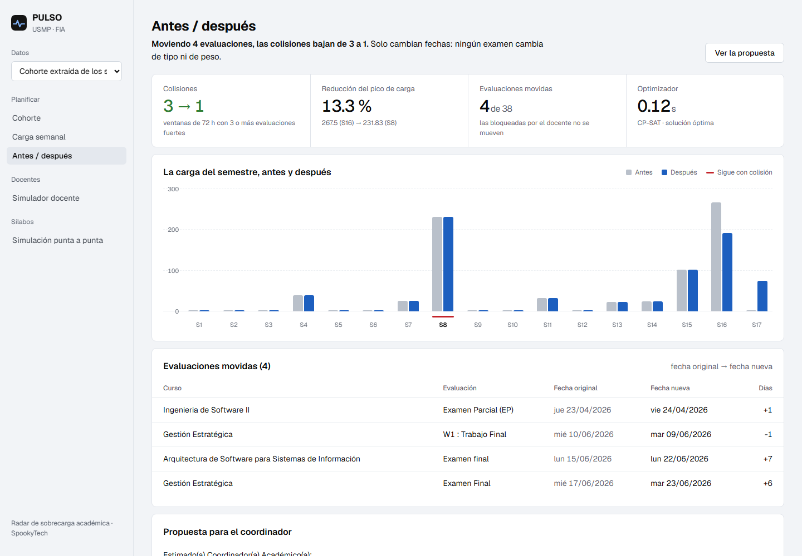
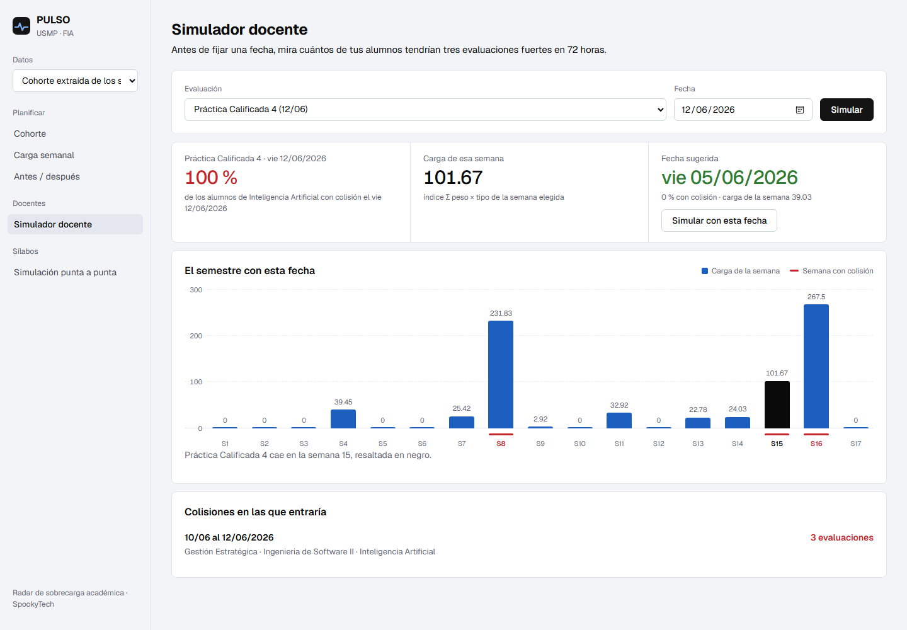
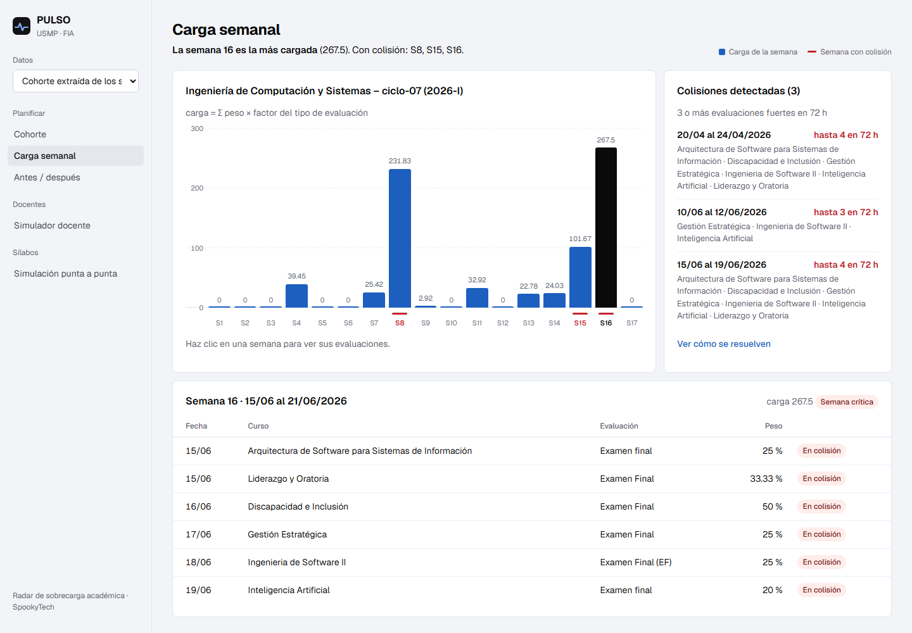
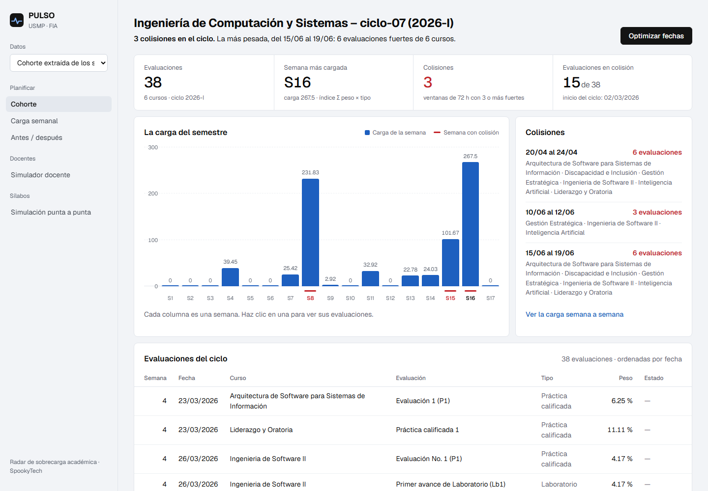

# PULSO

**Radar predictivo de sobrecarga académica.** Equipo **SpookyTech** (USMP) · Hackathon ENEISOFT XVI (FISI-UNMSM) · sub-eje Bienestar.

> **Mi sistema es PULSO**, un radar que lee los sílabos y mide la carga académica de cada semana.
> **Va a ayudar a** la coordinación y a los docentes a repartir las evaluaciones para que ningún estudiante tenga tres exámenes fuertes en 72 horas.

## Problema

Al inicio del semestre, el Departamento Académico y la Coordinación programan parciales y finales, y cada docente fija sus prácticas
y trabajos. Todos deciden **sin ver la semana completa del estudiante**. Con los sílabos reales del ciclo 7 de Ingeniería de
Computación y Sistemas (USMP, 2026-I):

- en la **semana 8** los seis cursos toman parcial, y en la **16** los seis toman final;
- hay **3 colisiones**: momentos con 3 o más evaluaciones fuertes en 72 horas.

El reglamento solo atiende el choque exacto de día y hora, a pedido del alumno y después de que ocurre (art. 20). La sobrecarga
se puede prever desde el primer día, porque ya está escrita en los sílabos.

## Solución

| Paso | Qué hace |
|---|---|
| **Leer** | Convierte cada sílabo PDF en texto (conservando el cronograma por semanas) y una IA extrae cada evaluación: tipo, semana y peso en la nota, calculado desde la fórmula del promedio. Se valida y, si falla, se corrige sola. |
| **Medir** | Calcula la carga de cada semana (`Σ peso × factor de tipo`) y detecta colisiones: ≥ 3 evaluaciones fuertes en 72 h. |
| **Optimizar** | Un optimizador matemático (CP-SAT de Google OR-Tools) busca el cambio de fechas más pequeño que baja el pico y las colisiones, sin mover lo bloqueado, sin feriados y respetando las semanas de exámenes. |
| **Proponer** | La IA redacta una propuesta para la coordinación con las cifras del optimizador, sin inventar datos. El **simulador docente** dice, antes de fijar una fecha, qué % de los alumnos chocaría y cuál es la mejor alternativa. |

## Demo

| Antes / después | Simulador docente |
|---|---|
|  |  |

| Carga semanal | Subir sílabos |
|---|---|
|  |  |

Recorrido de la demo, guion del pitch y preguntas frecuentes: [`docs/guion-pitch.md`](docs/guion-pitch.md).

## Resultados medidos

| Qué | Resultado |
|---|---|
| Extracción de Ingeniería de Software II (revisión manual) | **11/11** evaluaciones correctas, con semana y peso |
| Cohorte real ciclo 7 (6 sílabos, 38 evaluaciones) | colisiones **3 → 1**, pico −13.3 %, **4** evaluaciones movidas (resultado reproducible). La que queda son los parciales, que la facultad fija en la semana 8 |
| Cohorte de prueba (mock, 30 evaluaciones) | pico **−41.2 %**, colisiones 3 → 0 |
| Tiempo del optimizador | ~0.1–0.3 s |
| Simulación punta a punta desde caché | ~0.13 s, sin llamar a la IA |
| Tests | 150+ tests automáticos, en verde en GitHub Actions |

## Arquitectura

Monolito en Python: una sola app FastAPI sirve la interfaz web y la lógica, y se despliega en Vercel como una única función.

```
Sílabos PDF ─► pdf_reader (pdfplumber; visión si es escaneado)
            ─► llm_parser (OpenRouter · JSON schema · Pydantic · reintento con el error)
            ─► normalize (semana → fecha real, feriados, tipo)
            ─► batch (caché por PDF en data/cache/) ─► data/cohorte.json
                                     │
              engine: carga semanal + colisiones 72 h
                                     │
              optimizer: CP-SAT (pico + colisiones + movimientos) · simulador docente
                                     │
              proposal: propuesta para el coordinador (LLM, con plantilla de respaldo)
                                     │
              pipeline + api (/api/simular) ─► app FastAPI + Jinja2/HTMX ─► Vercel
```

| Capa | Tecnología |
|---|---|
| Modelo de datos | Pydantic v2 (`src/models.py`) |
| Extracción | pdfplumber + SDK `openai` contra OpenRouter |
| Optimización | Google OR-Tools (CP-SAT) |
| Web | FastAPI + Jinja2 + HTMX |
| Despliegue | Vercel (runtime Python) |
| Calidad | pytest + GitHub Actions |

Diseño que importa:
- **La IA lee y redacta; el optimizador decide.** Las fechas nuevas salen de CP-SAT, que garantiza las restricciones. El LLM nunca inventa cifras.
- **Solo se mueven fechas**, nunca el tipo, número ni peso de las evaluaciones (Reglamento USMP, art. 6).
- **La demo no depende de la IA en vivo**: cada sílabo se extrae una vez y queda en `data/cache/extraccion/`.

## Datos

- [`data/cohorte.json`](data/cohorte.json): cohorte **real**, ciclo 7 USMP 2026-I. Inicio oficial de clases 02/03/2026 (calendario FIA). 6 cursos, 38 evaluaciones.
- [`data/cache/extraccion/`](data/cache/extraccion): extracción de cada sílabo, indexada por el hash del PDF.
- [`data/silabos/`](data/silabos): 40 sílabos reales de los ciclos 1 a 7.
- [`data/mock/evaluaciones_mock.json`](data/mock/evaluaciones_mock.json): cohorte de prueba con 120 alumnos en 4 grupos de matrícula.

Regenerar la cohorte (sale de la caché, sin IA; solo los PDFs nuevos llaman al LLM):

```bash
python scripts/procesar_cohorte.py data/silabos/ciclo-07 --ciclo 2026-I --inicio 2026-03-02
```

Extraer y revisar un sílabo a mano: `python scripts/extraer_silabo.py <pdf>`.

## API

| Método | Ruta | Qué hace |
|---|---|---|
| `GET` | `/api/presets` | Cohortes de prueba disponibles |
| `GET` | `/api/simular?preset=ciclo-07&propuesta=plantilla\|auto` | Simulación punta a punta: leer → medir → optimizar → proponer |
| `POST` | `/api/simular` | Lo mismo con sílabos subidos (multipart `archivos[]`, `ciclo`, `inicio`) |

Documentación interactiva en `/docs`.

## Ejecutar en local

Requiere Python 3.12 o superior.

```bash
python -m venv .venv
source .venv/bin/activate              # Windows: .venv\Scripts\activate
pip install -r requirements-dev.txt    # app + pytest (Vercel solo instala requirements.txt)
cp .env.example .env                   # LLM_API_KEY y LLM_MODEL de OpenRouter (opcional para la demo)
python scripts/verificar_entorno.py    # dependencias + llamada de prueba al LLM
uvicorn src.app:app --reload           # http://127.0.0.1:8000  → elegir "Cohorte extraída de los sílabos"
pytest -q
```

Variables de entorno (ver `.env.example`):

| Variable | Uso |
|---|---|
| `LLM_BASE_URL`, `LLM_API_KEY`, `LLM_MODEL` | OpenRouter. Sin key, la demo funciona igual: caché + propuesta con plantilla |
| `LLM_VISION_MODEL` | Opcional, para sílabos escaneados |
| `LLM_MAX_TOKENS`, `LLM_REASONING` | Para modelos gratuitos que razonan mucho, p. ej. `nvidia/nemotron-3.5-super-vl:free` con `20000` y `auto` |

## Despliegue en Vercel

Lo recomendado es conectar el repositorio de GitHub al proyecto de Vercel (Project → Settings → Git): **cada merge a `main` se despliega solo**.
Sin esa conexión, un `vercel --prod` despliega una copia fija de la carpeta local de quien lo corre, y no refleja los merges posteriores.

```bash
npm i -g vercel
vercel link
vercel env add LLM_API_KEY             # y LLM_BASE_URL / LLM_MODEL
vercel --prod                          # solo si no está conectada la integración con GitHub
```

- Vercel detecta `src/app.py` como entrypoint FastAPI. `vercel.json` excluye `data/silabos/`, `tests/` y `scripts/` del bundle.
- El filesystem es de solo lectura: la cohorte y la caché van commiteadas; los PDFs nuevos se cachean en `/tmp`.
- El body de cada petición tiene un límite de ~4.5 MB: la subida acepta hasta 4 MB de PDFs.

## Viabilidad

Revisado contra el **Reglamento de Evaluación del Aprendizaje de la USMP** y el **calendario FIA 2026-I**:

- parciales y finales los programa el Departamento Académico al inicio del semestre, y el resto de evaluaciones queda a criterio de cada docente (art. 7);
- el tipo y número de evaluaciones no cambian (art. 6), y por eso PULSO solo propone fechas;
- hoy solo hay excepción para choques exactos de día y hora (art. 20).

Stakeholders, encaje en el proceso, riesgos y fuentes: [`docs/viabilidad.md`](docs/viabilidad.md).

Siguientes pasos sugeridos por los mentores: sílabo + **horario personal**, datos reales de **matrícula** y **balanceador de aulas**.

## Estructura

```
├── data/            cohorte.json · cache/extraccion/ · silabos/ · mock/
├── docs/            viabilidad.md · guion-pitch.md · img/
├── scripts/         procesar_cohorte.py · extraer_silabo.py · verificar_entorno.py
├── src/
│   ├── models.py    Evaluacion · Cohorte · GrupoMatricula
│   ├── extraction/  pdf_reader · llm_parser · normalize · batch · proposal · llm
│   ├── engine/      load_index · collisions
│   ├── optimizer/   cpsat_model · objective · simulator
│   ├── pipeline.py  simulación punta a punta
│   ├── api.py       /api/simular
│   ├── app.py       app FastAPI (entrypoint de Vercel)
│   └── ui/          templates/ · static/
├── tests/
└── vercel.json
```

## Equipo

**SpookyTech** — Universidad de San Martín de Porres (USMP): Emily Peralta Cenepo · Viviana Flores Montes · Sergio Ascurra Perez.

Flujo de trabajo: ramas `feat/<módulo>-<descripción>`, commits [Conventional Commits](https://www.conventionalcommits.org/) en español
y un PR por tarea hacia `main`. Las reglas están en [`CLAUDE.md`](CLAUDE.md).
